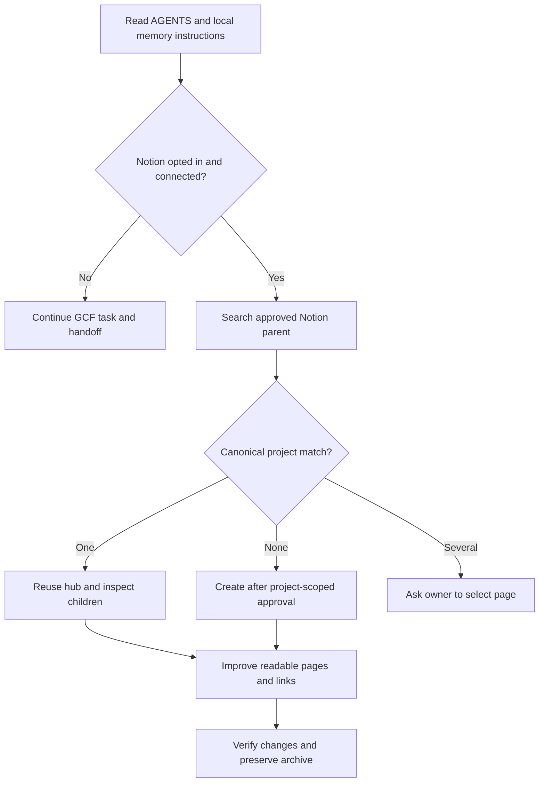

# Engineering Project Memory — recommended Notion layout

**Purpose:** a small canonical project hub with reusable topic pages. This is a
reference for an opted-in project, **not** a separate Notion client or an
instruction to create duplicate pages. Preserve any existing page structure.
**If Notion is disabled or unconfigured, do not use this workflow at all.**
Never delay GCF Task Resume, Task Inbox, Transfer Control or handoffs for a
Notion setup, login, read, write or unavailable Notion service.

## Audience and quality bar

- **Human first:** each page opens with a useful one- or two-sentence explanation, what changed and why it matters. Use recognizable terms, clear heading hierarchy and short paragraphs; explain unfamiliar abbreviations on first use. Prefer a short **30-second summary** and links to deeper technical detail.
- **AI-ready facts:** after the readable introduction, separate **Purpose**, **Verified state**, **Architecture / interfaces**, **Decisions and rationale**, **Known constraints**, **Evidence**, **Next strategic action** as relevant. Include source paths relative to the repository, real commands/results with dates, and links to authoritative code/docs rather than unverifiable claims.
- **Provenance:** clearly mark `Proposed / Decided / Implemented / Verified / Blocked / Superseded`. Quote only brief safe excerpts and distinguish observed tests from historical claims. Preserve dates and attribution; never present inferred behavior as tested.
- **Navigation:** one canonical hub per actual project, a compact linked list of topic pages, meaningful headings and minimal duplication. Do not require 8 pages for a small codebase; use only pages with distinct, enduring purpose. Avoid endless chronology in the main hub.
- **Diagrams:** add a small **Mermaid** flowchart, sequence diagram, state diagram or ER diagram when it answers a real architectural/process question faster than prose. Notion supports `mermaid` code blocks; keep diagrams small, grounded in verified code, captioned and explained in text (also useful if rendering is unavailable). Avoid speculative nodes, dense graphs, theme-specific tricks, untrusted links and raw secrets. Test syntax or inspect Notion preview; fall back to a plain-text explanation if rendering fails.

## Before organizing

1. Resolve the **existing canonical project page** using the approved `notion_page_url` or scoped search under the user-approved parent. Match project title and repository identity, then read its existing child pages. A local Markdown template is **not** a Notion page; Notion OAuth/connection alone is **not** permission to create arbitrary pages. If nothing matches, create one hub and needed child pages **only** within the explicitly approved parent and project-specific creation scope; otherwise request permission.
2. Read the live repository's `AGENTS.md`, status, Git changes, and relevant
   tests. Separate verified state from proposals and historical reports.
3. Inventory existing topic pages first. **Reuse them**; create only missing,
   genuinely necessary children after user authorization.
4. **Refactor without losing history:** inventory each legacy section and subpage, map it to a retained topic or Archive, and present a clear before/after summary before material rearrangement. Prefer additive headings, links and selective edits over a full rewrite. For long or tangled pages, create a native Notion duplicate or an authorized Archive copy **before** replacing old text; verify that copied paragraphs, headings, dates, links and nested pages are complete. Keep the original canonical project URL and update it in place only after verification. Archive **superseded** material rather than moving current facts, and get the owner's approval before materially relocating or replacing old content.
5. **Protected blocks:** preserve exact child-page, database, attachment and synced-block references. Never use bulk delete, overwrite unrelated owner notes, erase source history or falsely report that an Archive copy succeeded. If the connector cannot safely duplicate/move a block, stop at a non-destructive draft and report the limitation.

## Canonical hub (target roughly 150–250 words)

| Field | Contents |
| --- | --- |
| Product / purpose | One-sentence project outcome and users |
| Repository | Public repo URL if known; Git branch/dirty state verified today |
| Current phase | Implemented and verified scope, not an estimated completion % |
| Last verified | Date, command/result, path/commit or exact external evidence |
| Safety / blocker | The one most important constraint |
| Next action | One concrete step with acceptance criterion |

Add navigation to the existing topic pages. Do not paste chat transcripts,
raw logs or several hundred dated headings into this hub.

## Optional topic pages (adapt to the actual project)

- **01 Cockpit:** purpose, current strategic phase, last verified, strategic next action and links; **not** a duplicate of GCF's task handoff.
- **02 Product / UX:** user outcomes, acceptance criteria, non-goals.
- **03 Architecture:** components, code paths, trust boundaries, contracts.
- **04 Roadmap:** top three next tasks, with ownership, status and Done checks.
- **05 Quality:** dated evidence ledger (exact command, result, limits).
- **06 Decisions / Risks:** rationale and status of accepted, proposed and
  superseded decisions; security and release gates.
- **07 References:** source-of-truth locations, research with links and dates.
- **99 Archive:** superseded milestones and the fully preserved original page
  when a large hub was shortened.

Do not force this numbering on a project with a different existing hierarchy.
Never make a second canonical page for the same product.

## Example: project-memory bootstrap flow (illustrative)

Use a Mermaid code block with language `mermaid` in the relevant Notion architecture/process page. The diagram below describes the **instruction-driven workflow**, not an always-on service. Keep an accompanying text summary for accessibility and AI retrieval.

The agent reads local project context and uses its **separately authorized Notion client** only after the user opted in. A unique matching hub is reused, a missing hub is created only in an approved scope, and ambiguous matches require human selection. All existing task handoffs stay in GCF.

## Useful page structure (adapt to the project)

For each topic page, prefer **Why it matters → What is verified → How it works → Evidence / links → Limitations / next strategic action**. Skip empty sections. A brief nontechnical introduction explains the value to a reader; technical sections let the AI locate exact concepts without scanning conversational history. Put diagrams beside the explanation they clarify, not on every page. Preserve original decision records and archival provenance.

## Routine agent workflow: no second handoff database

- **Current task truth:** when connected, use GCF `shared_project_state` and
  `task_resume`; consult `task_inbox_list` / `task_inbox_read` only when relevant.
  These are advisory records, not verified execution or agent identity. When
  disconnected, read permitted local Git and project notes and state that live
  GCF task state could not be checked.
- **Long-lived memory:** read the Notion hub/Cockpit and one relevant child.
  Validate against current source, Git and tests; do not use Notion as a
  substitute for a running handoff or its execution status.
- **Consolidation filter:** write durable decisions with rationale, material
  architecture/security changes, verified root-cause lessons, lasting risks
  and significant product milestones. Skip ordinary handoff events, transient
  TODOs, repeated test runs and per-session progress already in GCF.
- **Deduplicate:** search the existing topic/decision before writing. Update
  the same record when equivalent; label conflicting earlier choices
  **Superseded** and link to the accepted replacement. Create a new record only
  when genuinely distinct and authorized; never create duplicate project hubs.
- **Evidence:** 5–10 factual lines per real memory change, with relative code
  paths, dated test commands/results and optionally a task ID as a pointer —
  never task/inbox payloads or full logs. Refresh Cockpit only when the durable
  current project state changes.
- **Handoff ownership:** focus, completed, next, blocker, touched paths and last
  check belong to the existing GCF task/handoff mechanism. Notion may contain
  a brief strategic next action, not a second copy of the task queue.
- **Verification:** read back material Notion edits. Report
  `NOTION_SYNC_VERIFIED` only after actual connector evidence, otherwise
  `NOTION_SYNC_PENDING`. No secrets, private paths, customer data, raw source
  dumps, new Notion privileges or background execution.
