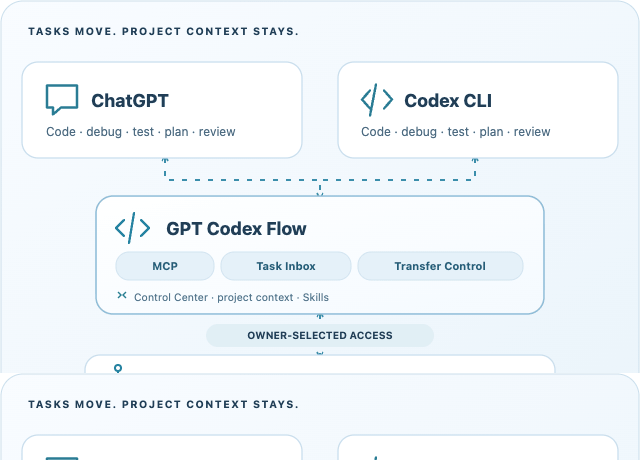
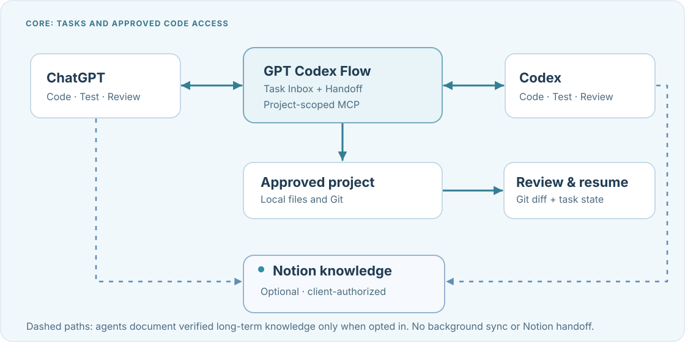

<p align="center"></p>
<h1 align="center">GPT Codex Flow</h1>
<p align="center"><strong>Two coding assistants. One project workflow.</strong></p>
<p align="center">Connect ChatGPT to approved local projects, hand off tasks to Codex, and review changes in Git.</p>
<p align="center">
  
  
  
  <a href="https://github.com/haiderhamad/gpt-codex-flow/releases/tag/v1.0.1"></a>
  <a href="https://haiderhamad.github.io/gpt-codex-flow/"></a>
  <a href="LICENSE"></a>
</p>
<p align="center"><a href="https://haiderhamad.github.io/gpt-codex-flow/">Official Website</a> · <a href="#features">Features</a> · <a href="#quick-start">Quick Start</a> · <a href="#optional-agent-assisted-notion-project-memory">Notion Memory</a> · <a href="#security">Security</a> · <a href="#troubleshooting">Troubleshooting</a></p>

<p align="center"></p>

## Features

- 🔒 **Approved project folders** — grant ChatGPT only the local files and permissions you select.
- 💻 **Both assistants can code** — ChatGPT and Codex can edit, test, debug and review when authorized. If Codex is unavailable, an active ChatGPT session can continue coding through authorized MCP edit/test tools.
- 🔄 **Durable handoffs** — Task Inbox, Transfer Control and `task_resume` keep recorded task context across conversations.
- 🔍 **Git review** — inspect diffs and test evidence before accepting changes.
- 🖥️ **Local Control Center** — manage Projects, Connections, permissions and advisory lead settings in a browser.
- 🧩 **Skills & Agent Profiles** — discover coding/review guidance; profiles do not automatically launch agents.
- 📚 **Optional Notion Memory** — keep verified long-term project knowledge with separately authorized agents. It does not replace handoffs or run a background sync.

<p align="center"></p>

## Quick start

Install from GitHub, open the **local Control Center**, approve a folder, then connect ChatGPT. Files stay on your computer unless an authorized MCP request sends their contents to the connected client.

### 1. Prerequisites

- **Node.js 20+**, npm and Git. Check with `node --version`, `npm --version` and `git --version`.
- **[cloudflared](https://developers.cloudflare.com/tunnel/downloads/)** on your PATH (`cloudflared --version`); Quick Tunnel needs internet access but no Cloudflare account or domain.
- A ChatGPT account/workspace with **custom MCP server** support (availability varies).

**Codex CLI is optional** for ChatGPT-only workflows. Install it separately if you want local Codex handoffs.

### 2. Install from source

```bash
git clone https://github.com/haiderhamad/gpt-codex-flow.git
cd gpt-codex-flow
npm ci
```

Run `npm ci` **inside the cloned folder**, which contains `package-lock.json`. This repository is not published as an npm package.

### 3. Open Control Center

```bash
npm run gcf:ui
```

The local-only Control Center opens in your browser. Enter the **one-use unlock code** printed in Terminal (valid for **5 minutes**) and keep Terminal running. This does not launch Codex or a public tunnel.

### 4. Approve a project

Open **Projects → Add Folder**, choose a development folder and confirm access locally. Start with **Read Only** source access. Adding a folder does not copy or upload it; removing it from Control Center does not delete it. Git-specific features need a Git repository, but non-Git folders can still be approved.

### 5. Connect ChatGPT

**Cloudflare Quick Tunnel is the only supported user-facing connection.** It is temporary development/testing connectivity, **not guaranteed production hosting** ([Cloudflare documentation](https://developers.cloudflare.com/tunnel/get-started/quick-tunnels/)).

1. In **Connections → Connect ChatGPT**, select approved projects and an access level (start with **Read Only**).
2. Choose **Start Cloudflare**, confirm locally and check for **Cloudflare tunnel ready**.
3. **Copy Connection URL**. The URL contains a **secret access token**: never share it in a chat, issue or screenshot.
4. Add the copied URL as a **custom MCP server** in ChatGPT. Select **No authentication** in ChatGPT's connection form; GCF still validates the secret token in the URL.
5. In a new connected ChatGPT conversation, request `list_projects`, select the approved folder, then call `project_summary`. Verify that **only** approved projects are visible. A ready tunnel alone does not prove a client connection.

**Disconnect:** Use **Disconnect** in Control Center, then `Ctrl+C` in Terminal. If the tunnel URL changes, update the ChatGPT connection.

### Access levels

| Connection level | Source files | Terminal commands | Handoff notes |
| --- | --- | --- | --- |
| **Read Only** (recommended first) | Read only | Off | Allowed in scoped `.ai-bridge/` metadata |
| **Edit Files** | Read/write in approved folders | Off | Allowed |
| **Edit & Test** | Read/write in approved folders | Safe allowlisted Bash | Allowed |
| **Full Access** (manual Advanced; high risk) | Read/write | Full Bash | Allowed |

**Full Access is not available through the one-click Cloudflare UI.** Handoff notes remain writable in every access level, including Read Only, but never grant source edits or command execution. **ChatGPT's own approval settings do not replace server permissions.**

<p align="center"></p>

## Optional: Codex CLI

Codex CLI is needed only for local Codex execution, not to start GCF or connect ChatGPT. For npm-managed installations:

```bash
npm install -g @openai/codex@latest
codex --version
codex
```

Follow `codex` sign-in prompts. If your macOS installation uses Homebrew, use `brew install --cask codex` (new) or `brew upgrade --cask codex` (update) instead. **Do not mix installation methods.** See the [official Codex instructions](https://github.com/openai/codex#installing-and-running-codex-cli). GCF does not install Codex or start it merely because a Lead/model setting was selected.

## Optional agent-assisted Notion project memory

**Notion Memory is off by default.** It records durable verified project decisions and architecture, separate from GCF Task Inbox and Handoff. It works for new and already registered projects without overwriting source, Git history, `AGENTS.md` or `.ai-bridge/`.

<p align="center"></p>

*Dashed paths show optional, client-authorized documentation—not automatic sync.* [View the diagram full-size](docs/gcf-preview/notion-memory-flow.svg).

1. **Enable:** In **Control Center → Projects**, select an approved folder and **Enable Notion Memory** (or opt in during **Add Folder**), then confirm. GCF creates `NOTION_MEMORY.md` safely if absent; it never edits existing `AGENTS.md`. You may instead copy guidance from **Connections → ChatGPT Project Instructions**. For offline Codex discovery, copy the short `AGENTS.md` pointer shown there.
2. **Connect:** Independently authorize the official Notion integration in the ChatGPT/Codex client. Set `notion_page_url` for an existing project hub or an owner-approved `notion_parent_url`. Agents reuse the matching project page; creating one requires explicit project-specific approval, and ambiguous matches must be resolved first.
3. **Maintain:** Agents document meaningful, verified decisions during active sessions, avoid duplicate pages and preserve existing notes. Keep the hub concise for humans and AI; use [optional Mermaid architecture diagrams](.agents/skills/gcf-notion-memory/references/PROJECT_HUB_LAYOUT.md) when helpful. Major reorganizations need approval and verified archival copies.

**Notion never blocks GCF.** These project-local files are instructions, not a Notion login or evidence of a saved page. There is **no automatic background sync**. With Notion opted in but disconnected, only documentation is `NOTION_SYNC_PENDING`; without opt-in, no sync warning appears. `shared_project_state`, `task_resume`, Task Inbox and Transfer Control continue working independently. Re-copy Project Instructions and reconnect MCP clients after guidance updates. See the [Notion Memory Skill](.agents/skills/gcf-notion-memory/SKILL.md).

For a separately authorized local Codex session:

```bash
codex mcp add notion --url https://mcp.notion.com/mcp
codex mcp login notion
codex mcp list
```

The login uses interactive OAuth; local Codex needs file access for offline instruction discovery. `npm run test:gcf-notion-codex-offline` verifies local discovery only, **not** remote Notion writes.

## Security

- **Permissions:** Handoff notes are scoped `.ai-bridge/` metadata. They do not grant code edits or Bash. Command allowlists are **not** an OS sandbox.
- **Codex sandbox:** Normal native tasks request `workspace-write` with network disabled. The Codex sandbox does not contain independent MCP file/Bash tools. Codex **Full Access** is a separate, owner-attended high-risk mode prohibited in Local Auto. Control Center remains local, never exposed through the tunnel.
- **Lead mode:** **ChatGPT Lead**, **Codex Lead** and **Auto — Recommend** are advisory choices, separate from permissions and actual model execution. **Transfer Control records a handoff**; accepting one cannot grant access or launch Codex. GCF does not sync hidden conversations, bypass quotas, authenticate model identity, offer a multi-item backlog or install an OS login service. Windows-native sandbox containment is unverified.
- **Model and reasoning settings:** In **Control Center → Workflow**, choose the approved project, select **Codex model** (Runner default or model ID) and **Reasoning** (Model default, Low, Medium, High, Extra High), then **Save Codex execution settings**. These are owner-only local preferences, separate from Lead mode. **Inspect Codex execution readiness** displays an explicit owner-reviewed Terminal command with `--model` and `--effort` when configured; nothing runs automatically. The runner uses `--ignore-user-config`, so **Runner default may differ from your personal `~/.codex/config.toml` selection**; actual model availability and identity are not verified. The independent Local Auto worker does **not** inherit Dashboard model settings automatically.

See [SECURITY.md](SECURITY.md) for trust boundaries and [native sandbox decisions](docs/GCF_NATIVE_SANDBOX_V1_DECISION.md) for implementation details.

## Troubleshooting

| Symptom | What to check |
| --- | --- |
| `npm ci` cannot find `package-lock.json` or `gcf:ui` is missing | Run commands inside the cloned `gpt-codex-flow` folder. |
| Control Center does not open | Use the local URL printed in Terminal; keep Terminal open. |
| Unlock code expired | Restart `npm run gcf:ui` to get a new code. |
| `cloudflared` missing | Install it from the official download and restart Control Center. |
| Cloudflare connects but ChatGPT cannot see projects | Check the **secret URL**, selected folders, access level and tunnel status. **Do not** disable authentication or Host/Origin protections. |
| Offline install shows `ENOTCACHED` | Retry online; the npm cache lacks dependencies. |

## Development and upgrades

To verify a source checkout (Chrome/Chromium and Node.js 22+ are required for the visual-browser test):

```bash
npm run build
npm run test:gcf-core
npm run test:gcf-landing
npm run test:gcf-visual
npm run test:gcf-cloudflare-oneclick
npm run test:gcf-release-integrity
```

See [CONTRIBUTING.md](CONTRIBUTING.md) for contributions and [architecture history](docs/GCF_PROJECT_HISTORY.md) for design decisions. GitHub Pages hosts only the static Landing, **not** Control Center.

**Moving to another Mac:** Reinstall dependencies, reapprove folders and reconnect ChatGPT using a new private tunnel URL. Git does **not** restore ignored `.ai-bridge/` records, private configuration, credentials or uncommitted work; back these up separately.

**Upgrading from CodexBridge:** This is a **breaking change**, not an automatic migration. Back up old `~/.codexbridge/` and project `.ai-bridge/` state first. Reinstall GCF from source, then reapprove project roots and replace old `codexbridge` commands, `codexbridge_*` tool names, `codexbridge_token` parameters and `CODEXBRIDGE_*` variables. GCF uses `~/.gcf/` and `GCF_*` by default. Reissue a fresh private connection URL/token; do not overwrite or auto-migrate old handoffs before verifying them. Older installations have not all been migration-tested.

**Publishing privacy:** Review the destination repository and approved Git author identity before a push: old public commit metadata is not erased by a new release. Never publish tokens, `.env`, user-specific paths or private `.ai-bridge/` data. GitHub is not a backup for private local state.

## License

[MIT](LICENSE), based on [naplesblue/codexbridge](https://github.com/naplesblue/codexbridge). Original copyright notices are retained. GPT Codex Flow is independent, not an official OpenAI product.
