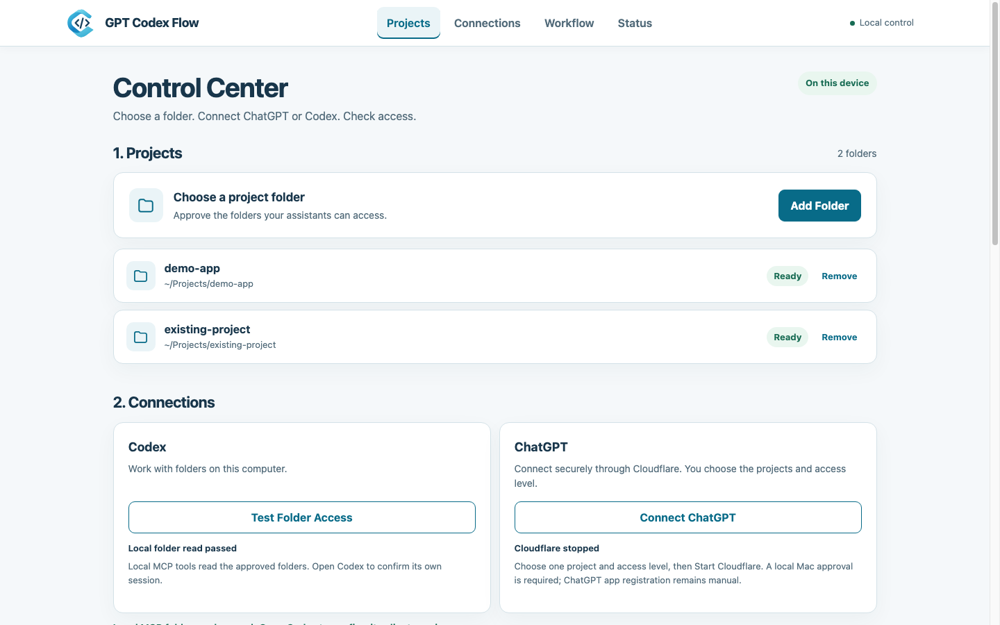
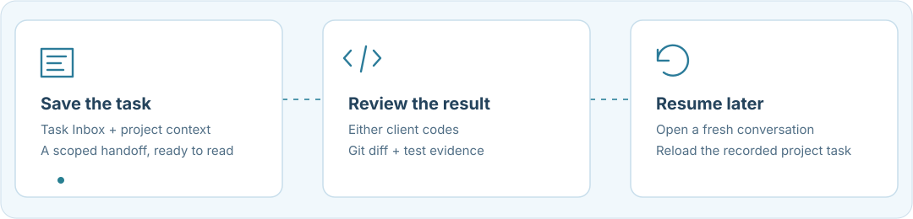

<p align="center"></p>
<h1 align="center">GPT Codex Flow</h1>
<p align="center"><strong>Two coding assistants. One project workflow.</strong></p>
<p align="center">Connect ChatGPT to approved local projects, hand off tasks to Codex, and review changes in Git.</p>
<p align="center">
  
  
  
  <a href="LICENSE"></a>
</p>
<p align="center"><a href="#quick-start">Quick Start</a> · <a href="#features">Features</a> · <a href="#security">Security</a> · <a href="#troubleshooting">Troubleshooting</a></p>

<p align="center"></p>

## Quick start

Install GPT Codex Flow, start the local **Control Center**, then connect ChatGPT to the project folders you approve. Project files remain on your computer; ChatGPT can receive file contents through authorized MCP requests according to the access level you select.

### 1. Prerequisites

- **Node.js 20+** with npm, and **Git**. Check in Terminal with `node --version`, `npm --version` and `git --version`.
- **[cloudflared](https://developers.cloudflare.com/tunnel/downloads/)** installed and available on your PATH (`cloudflared --version`). Cloudflare Quick Tunnel requires an internet connection, but **not** a Cloudflare account or domain.
- A ChatGPT account/workspace that supports adding a **custom MCP server**. This availability depends on the account and workspace.
- **Optional:** an installed, signed-in Codex CLI if you want to run local Codex tasks. It is not needed merely to start the Control Center.

### 2. Installation

Clone the repository, enter its folder, and install dependencies:

```bash
git clone https://github.com/haiderhamad/gpt-codex-flow.git
cd gpt-codex-flow
npm ci
```

Run these commands in Terminal. `npm ci` uses the repository's `package-lock.json`, so it must run **inside the cloned `gpt-codex-flow` folder**, not from your home directory (`~`).

### 3. Start the Control Center

From the same `gpt-codex-flow` folder, run:

```bash
npm run gcf:ui
```

This command builds the project and starts a **local-only** Control Center. It normally opens your browser automatically. Terminal shows a local URL and a **one-use unlock code (valid for 5 minutes)**. Paste that code into the browser unlock screen. **Keep the Terminal open** for the Control Center to remain running. The owner session expires after inactivity. Starting the Control Center does **not** start a public tunnel, register ChatGPT or run Codex.

### 4. Add a project

In the Control Center, open **Projects**, choose **Add Folder**, select the folder you want ChatGPT to access, review the local confirmation, and approve it. The folder is not copied or uploaded. For a first test, choose an ordinary development/test folder and start with **Read Only** source access. Non-Git folders are supported; Git-specific diffs and handoffs need a Git repository. Removing a project from the Control Center does **not** delete the underlying folder.

### 5. Connect ChatGPT

**Cloudflare Quick Tunnel is the only supported user-facing connection.** Go to **Connections → Connect ChatGPT** in the Control Center:

1. Select your approved project(s) and the connection access level; start with **Read Only**.
2. Choose **Start Cloudflare** and approve the **local** confirmation. Wait until the Control Center shows **Cloudflare tunnel ready**.
3. Click **Copy Connection URL**. It contains a **secret access token**. Never paste the URL into a chat, issue, screenshot or Git repository.
4. In ChatGPT, go to the area for **custom MCP server / app connections** (menu names vary by account), add a server using the copied URL, and select **No authentication** *for the ChatGPT connection setup*. GCF itself still authenticates requests using the secret embedded in the URL.
5. In a new ChatGPT conversation with the connection enabled, ask it to call `list_projects`, select the specific approved project, and call `project_summary`. Verify it sees **only** the folders you selected. A ready tunnel by itself is not proof that ChatGPT connected.

**Disconnect:** Click **Disconnect** in the Control Center, then press `Ctrl+C` in Terminal to stop the local app. The next Cloudflare Quick Tunnel may use a new private URL; update your ChatGPT connection if it changes. No additional HTTP server setup is needed.

### Access levels

| Connection level | Source files | Terminal commands | Handoff notes |
| --- | --- | --- | --- |
| **Read Only** (recommended first) | Read only | Off | Allowed in scoped `.ai-bridge/` metadata |
| **Edit Files** | Read/write in approved folders | Off | Allowed |
| **Edit & Test** | Read/write in approved folders | Safe allowlisted Bash | Allowed |
| **Full Access** (manual Advanced only; high risk) | Read/write | Full Bash | Allowed |

**Full Access is not available through the one-click Cloudflare UI.** Use only the permissions required for your task. **Handoff notes remain writable in every access level**, including Read Only, but notes do not grant code editing or command execution. ChatGPT's approvals do not override the permission level selected here.

<p align="center"></p>

## Troubleshooting

| Symptom | What to check |
| --- | --- |
| `npm ci` cannot find `package-lock.json` | Run `cd gpt-codex-flow` before `npm ci`. |
| `npm run gcf:ui` says **Missing script** | Same issue: check that you are in the folder containing this project's `package.json`. |
| Browser does not open | Use the **local URL printed in Terminal**; keep Terminal running. |
| Unlock code expired | Restart `npm run gcf:ui` to obtain a new one-use code. |
| `cloudflared` missing | Install from the official Cloudflare instructions, then restart the Control Center. |
| Cloudflare starts but ChatGPT cannot read projects | Check the exact private URL, ChatGPT connection permissions, selected folders and that the tunnel still shows ready. Do **not** disable authentication or Host/Origin restrictions. |
| Offline install reports `ENOTCACHED` | The npm cache lacks dependencies. Retry while online. |

## Features

- 🔒 **Project-scoped access** — approve exactly which folders ChatGPT can access. Git operations require a Git repository.
- 💻 **Both assistants can code** — ChatGPT edits and tests through authorized MCP tools; local Codex handles separately approved tasks. If Codex is unavailable, an active ChatGPT session can continue coding through authorized MCP edit/test tools.
- 🔄 **Durable handoffs** — Task Inbox, Transfer Control and continuity checkpoints preserve recorded task context.
- 🔍 **Git review** — inspect diffs, test evidence and return receipts before continuing.
- 🖥️ **Local Control Center** — manage projects, Cloudflare access and advisory lead preferences in your browser.
- 🧩 **Skills & Agent Profiles** — discover instructions for coding and review; profiles do not automatically start agents.

<p align="center"></p>

## Security

**Handoff notes remain writable in every access level**, including Read Only, but only as scoped `.ai-bridge/` metadata; notes are not permission to edit source files or execute commands. ChatGPT's own approval settings do not replace server permissions. Command allowlists are not an OS sandbox.

Ordinary native Codex tasks request `workspace-write` with sandbox network disabled. The native **Codex sandbox** does not cover independent MCP file/Bash tools. Codex `--full-access` is a separate owner-attended high-risk option and prohibited in Local Auto. The local Control Center is never exposed via the public tunnel.

**ChatGPT Lead**, **Codex Lead** and **Auto — Recommend** are advisory choices. **Transfer Control** records a handoff; accepting one does not grant execution permissions or start a model. GCF does not synchronize hidden conversations, bypass account limits, authenticate model identity, provide a multi-item backlog, or install an OS login service. Windows-native sandbox containment remains unverified.

See [security policy and release boundaries](SECURITY.md), [Codex sandbox decision](docs/GCF_NATIVE_SANDBOX_V1_DECISION.md) and [feature evidence](docs/GCF_FEATURES_SOURCE_OF_TRUTH.md).

## Development

To verify a source checkout (the browser visual test additionally needs Node.js 22+ and Chrome/Chromium):

```bash
npm run build
npm run test:gcf-core
npm run test:gcf-landing
npm run test:gcf-visual
npm run test:gcf-cloudflare-oneclick
npm run test:gcf-release-integrity
```

If you move to a different computer, install the dependencies again, reapprove your project folders, and reconnect ChatGPT using a new private tunnel URL. Your credentials, ignored `.ai-bridge/` records, local configuration and uncommitted work are **not** included in a Git clone; back up anything you need separately.

For source contributions see [CONTRIBUTING.md](CONTRIBUTING.md). For more detail see the [architecture decisions](docs/GCF_PROJECT_HISTORY.md). GitHub Pages contains only the static Landing, not the local Control Center.

## License

[MIT](LICENSE), based on [naplesblue/codexbridge](https://github.com/naplesblue/codexbridge). The original copyright notice is retained. GPT Codex Flow is an independent project, not an official OpenAI product.
